# CNA Mobile Store — Entity Relationship Diagrams (ERD)

نمودارهای جامع روابط موجودیت‌ها (ERD) پایگاه داده فروشگاه CNA به فرمت استاندارد Mermaid و دیاگرام‌های ساختاریافته ASCII.

---

## ۱. نقشه کلان زیرسیستم‌های پایگاه داده (System Architecture ERD)

```mermaid
graph TD
    subgraph Auth_RBAC ["۱. احراز هویت و دسترسی"]
        AU["auth.users (Supabase)"]
        P["profiles"]
        AR["auth_roles"]
        AP["auth_permissions"]
        ARP["auth_role_permissions"]
        AUR["auth_user_roles"]
        UA["user_addresses"]
    end

    subgraph Catalog_Specs ["۲. کاتالوگ و مشخصات کانونیکال"]
        C["categories"]
        B["brands"]
        PR["products"]
        PI["product_images"]
        AD["attribute_definitions"]
        CA["category_attributes"]
        PAV["product_attribute_values (Canonical Truth)"]
        W["warranties"]
        PV["product_variants (SKUs)"]
        PSU["product_serial_units (IMEI & Serials)"]
    end

    subgraph Inventory_Hub ["۳. انبارداری و زنجیره تأمین"]
        WH["warehouses"]
        WS["warehouse_stock (Projection)"]
        SM["stock_movements (Canonical Ledger)"]
        SR["stock_reservations (15min TTL Lock)"]
        IT["inventory_transfers"]
        ITI["inventory_transfer_items"]
    end

    subgraph Orders_Checkout ["۴. سفارشات و خرید"]
        CRT["carts"]
        CI["cart_items"]
        O["orders (Dynamic CNA-YEAR-SEQ)"]
        OI["order_items (Snapshots)"]
        OSH["order_status_history"]
        OR["order_returns (RMA)"]
    end

    subgraph Finance_Payments ["۵. امور مالی، مالیات و درگاه"]
        TR["tax_rules (Versioned VAT)"]
        WL["wallets"]
        WT["wallet_transactions (Audit Sub-Ledger)"]
        INV["invoices (Official Invoice)"]
        PAY["payments"]
        PT["payment_transactions (IPG Attempts)"]
        PWL["payment_webhook_logs (Idempotent)"]
    end

    subgraph Logistics_Care ["۶. لجستیک و ارتباط با مشتری"]
        SMTH["shipping_methods"]
        SHP["shipments"]
        STE["shipment_tracking_events"]
        CPN["coupons"]
        CPU["coupon_usages"]
        LP["loyalty_points"]
        WSH["wishlists"]
        REV["reviews"]
        TKT["support_tickets"]
        TM["ticket_messages"]
        NOTIF["notifications"]
        SET["store_settings (Configurable Retention)"]
        LOG["admin_audit_logs"]
    end

    %% Key Relationships
    AU -->|1:1| P
    AU -->|1:N| AUR
    AR -->|1:N| AUR
    AR -->|1:N| ARP
    AP -->|1:N| ARP
    P -->|1:N| UA

    C -->|1:N| PR
    B -->|1:N| PR
    PR -->|1:N| PI
    PR -->|1:N| PV
    PR -->|1:N| PAV
    AD -->|1:N| PAV
    W -->|1:N| PV
    PV -->|1:N| PSU

    WH -->|1:N| WS
    PV -->|1:N| WS
    WH -->|1:N| SM
    PV -->|1:N| SM
    WH -->|1:N| SR
    PV -->|1:N| SR

    AU -->|1:N| CRT
    CRT -->|1:N| CI
    PV -->|1:N| CI
    AU -->|1:N| O
    O -->|1:N| OI
    PV -->|1:N| OI
    O -->|1:N| OSH
    O -->|1:N| OR

    TR -->|1:N| O
    AU -->|1:1| WL
    WL -->|1:N| WT
    O -->|1:1| INV
    O -->|1:N| PAY
    PAY -->|1:N| PT

    O -->|1:N| SHP
    SMTH -->|1:N| SHP
    SHP -->|1:N| STE
    CPN -->|1:N| CPU
    O -->|1:N| CPU
    P -->|1:N| WSH
```



---

## ۲. دیاگرام جزئی موجودیت‌های رابطه ای (Detailed Mermaid ERD)

```mermaid
erDiagram
    auth_users ||--|| profiles : "has profile"
    auth_users ||--o{ auth_user_roles : "assigned to"
    auth_roles ||--o{ auth_user_roles : "grants"
    auth_roles ||--o{ auth_role_permissions : "includes"
    auth_permissions ||--o{ auth_role_permissions : "defines"
    profiles ||--o{ user_addresses : "registers"

    categories ||--o{ categories : "sub-categories"
    categories ||--o{ products : "classifies"
    brands ||--o{ products : "manufactures"
    products ||--o{ product_images : "showcases"
    products ||--o{ product_variants : "has variations"
    warranties ||--o{ product_variants : "guarantees"
    product_variants ||--o{ product_serial_units : "individual IMEIs"

    categories ||--o{ category_attributes : "requires"
    attribute_definitions ||--o{ category_attributes : "mapped in"
    products ||--o{ product_attribute_values : "has canonical values"
    attribute_definitions ||--o{ product_attribute_values : "specifies"

    warehouses ||--o{ warehouse_stock : "stores"
    product_variants ||--o{ warehouse_stock : "stocked in"
    warehouses ||--o{ stock_movements : "logs inbound/outbound"
    product_variants ||--o{ stock_movements : "canonical ledger"
    product_variants ||--o{ stock_reservations : "temporarily holds"

    carts ||--o{ cart_items : "contains"
    product_variants ||--o{ cart_items : "added to cart"

    orders ||--o{ order_items : "contains snapshots"
    product_variants ||--o{ order_items : "purchased SKU"
    orders ||--o{ order_status_history : "tracks transitions"
    orders ||--o{ order_returns : "subject to RMA"

    auth_users ||--|| wallets : "owns balance"
    wallets ||--o{ wallet_transactions : "audited by sub-ledger"

    orders ||--|| invoices : "generates official invoice"
    tax_rules ||--o{ orders : "applies versioned VAT"
    orders ||--o{ payments : "settled via"
    payments ||--o{ payment_transactions : "processed by IPG"

    orders ||--o{ shipments : "dispatched as"
    shipping_methods ||--o{ shipments : "carrier method"
    shipments ||--o{ shipment_tracking_events : "transit checkpoints"

    coupons ||--o{ coupon_usages : "redeemed in"
    orders ||--o{ coupon_usages : "discount applied"

    products ||--o{ reviews : "reviewed by"
    profiles ||--o{ reviews : "authored by"

    profiles ||--o{ support_tickets : "opened by"
    support_tickets ||--o{ ticket_messages : "contains messages"
```



---

## ۳. دیاگرام‌های ساختاریافته خوشه‌ای (Cluster ASCII Diagrams)

### خوشه ۱: امنیت، هویت و دسترسی‌پذیری تفکیک‌شده (Identity & RBAC)

```
┌────────────────────────┐         ┌────────────────────────┐
│      auth.users        │ 1     1 │        profiles        │
│ ────────────────────── │─────────│ ────────────────────── │
│ id (UUID, PK)          │         │ id (UUID, PK, FK)      │
│ email / phone          │         │ phone (VARCHAR, UQ)    │
└───────────┬────────────┘         │ full_name (VARCHAR)    │
            │ 1                    │ national_id (VARCHAR)  │
            │                      │ anonymized_at (TS)     │
            │                      └───────────┬────────────┘
            ▼ N                                │ 1
┌────────────────────────┐                     │
│    auth_user_roles     │                     ▼ N
│ ────────────────────── │         ┌────────────────────────┐
│ user_id (UUID, PK, FK) │         │     user_addresses     │
│ role_id (UUID, PK, FK) │         │ ────────────────────── │
│ assigned_at (TS)       │         │ id (UUID, PK)          │
└───────────▲────────────┘         │ user_id (UUID, FK)     │
            │ N                    │ recipient_name (VAR)   │
            │ 1                    │ postal_code (VARCHAR)  │
┌────────────────────────┐         │ address_detail (TEXT)  │
│       auth_roles       │         │ is_default (BOOLEAN)   │
│ ────────────────────── │         └────────────────────────┘
│ id (UUID, PK)          │
│ name (VARCHAR, UQ)     │
│ title_fa (VARCHAR)     │
└───────────┬────────────┘
            │ 1
            ▼ N
┌────────────────────────┐         ┌────────────────────────┐
│ auth_role_permissions  │ N     1 │    auth_permissions    │
│ ────────────────────── │─────────│ ────────────────────── │
│ role_id (UUID, PK, FK) │         │ id (UUID, PK)          │
│ perm_id (UUID, PK, FK) │         │ code (VARCHAR, UQ)     │
└────────────────────────┘         │ module (VARCHAR)       │
                                   └────────────────────────┘
```

---

### خوشه ۲: کاتالوگ، انبارداری و ردیابی شماره سریال IMEI

```
┌──────────────────┐       ┌──────────────────┐
│    categories    │       │      brands      │
│ ──────────────── │       │ ──────────────── │
│ id (UUID, PK)    │       │ id (UUID, PK)    │
│ parent_id (FK)   │       │ name_fa / en     │
└────────┬─────────┘       └────────┬─────────┘
         │ 1                        │ 1
         └────────────┬─────────────┘
                      ▼ N
┌─────────────────────────────────────────────┐
│                  products                   │
│ ─────────────────────────────────────────── │
│ id (UUID, PK)                               │
│ category_id (UUID, FK)                      │
│ brand_id (UUID, FK)                         │
│ slug (VARCHAR, UQ)                          │
│ title_fa / title_en (VARCHAR)               │
│ specs_summary (JSONB, Cached Projection)    │
└──────────────────────┬──────────────────────┘
                       │ 1
                       ▼ N
┌─────────────────────────────────────────────┐         ┌──────────────────────┐
│              product_variants               │ N     1 │      warranties      │
│ ─────────────────────────────────────────── │─────────│ ──────────────────── │
│ id (UUID, PK)                               │         │ id (UUID, PK)        │
│ product_id (UUID, FK)                       │         │ provider_name (VAR)  │
│ warranty_id (UUID, FK)                      │         │ duration_months (INT)│
│ sku (VARCHAR, UQ)                           │         └──────────────────────┘
│ color_name_fa / hex                         │
│ storage / ram (VARCHAR)                     │
│ price_toman (BIGINT)                        │
└──────┬────────────────┬──────────────┬──────┘
       │ 1              │ 1            │ 1
       │                │              │
       ▼ N              ▼ N            ▼ N
┌──────────────┐ ┌──────────────┐ ┌───────────────────────────┐
│warehouse_stoc│ │stock_movement│ │   product_serial_units    │
│───────────── │ │───────────── │ │ ───────────────────────── │
│warehouse_id  │ │qty_change    │ │ id (UUID, PK)             │
│variant_id    │ │balance_after │ │ variant_id (UUID, FK)     │
│shelf_location│ │movement_type │ │ imei1 (VARCHAR, UQ)       │
│quantity_on_h │ │operator_id   │ │ imei2 (VARCHAR)           │
│reserved_qty  │ └──────────────┘ │ serial_number (VAR, UQ)   │
└──────────────┘                  │ status (in_stock/sold)    │
                                  └───────────────────────────┘
```

---

### خوشه ۳: سفارشات، فاکتور منجمد مالی و دفاتر کل حسابداری

```
┌────────────────────────────────────────────────────────┐
│                         orders                         │
│ ────────────────────────────────────────────────────── │
│ id (UUID, PK)                                          │
│ order_number (VARCHAR, UQ) dynamic e.g. CNA-2026-10001 │
│ user_id (UUID, FK -> auth.users)                       │
│ status (pending/paid/packed/shipped)                   │
│ total_amount_toman (BIGINT)                            │
│ tax_rule_id (UUID, FK -> tax_rules)                    │
│ shipping_address_snapshot (JSONB)                      │
└───────────┬────────────────────────────┬───────────────┘
            │ 1                          │ 1
            │                            │
            ▼ N                          ▼ 1
┌──────────────────────────────┐ ┌──────────────────────────────┐
│         order_items          │ │           invoices           │
│ ──────────────────────────── │ │ ──────────────────────────── │
│ id (UUID, PK)                │ │ id (UUID, PK)                │
│ order_id (UUID, FK)          │ │ invoice_number (VARCHAR, UQ) │
│ variant_id (UUID, FK)        │ │ order_id (UUID, FK, UQ)      │
│ title_fa_snapshot (VARCHAR)  │ │ buyer_national_id (VARCHAR)  │
│ sku_snapshot (VARCHAR)       │ │ subtotal_toman (BIGINT)      │
│ unit_selling_price (BIGINT)  │ │ vat_amount_toman (BIGINT)    │
│ quantity (INT)               │ │ total_amount_toman (BIGINT)  │
│ total_line_amount (BIGINT)   │ │ tax_system_ref (VARCHAR)     │
└──────────────────────────────┘ └──────────────────────────────┘
            ▲
            │
┌───────────┴──────────────────┐
│           payments           │
│ ──────────────────────────── │
│ id (UUID, PK)                │
│ order_id (UUID, FK)          │
│ amount_toman (BIGINT)        │
│ method (online_ipg/wallet)   │
└───────────┬──────────────────┘
            │ 1
            ▼ N
┌──────────────────────────────┐         ┌──────────────────────────────┐
│     payment_transactions     │         │     wallet_transactions      │
│ ──────────────────────────── │         │ ──────────────────────────── │
│ id (UUID, PK)                │         │ id (UUID, PK)                │
│ gateway (mellat/saman/etc)   │         │ wallet_id (UUID, FK)         │
│ idempotency_key (VARCHAR, UQ)│         │ amount_toman (BIGINT)        │
│ shaparak_rrn (VARCHAR)       │         │ balance_after_toman (BIGINT) │
│ trace_number (VARCHAR)       │         │ transaction_type (credit)    │
└──────────────────────────────┘         └──────────────────────────────┘
```
